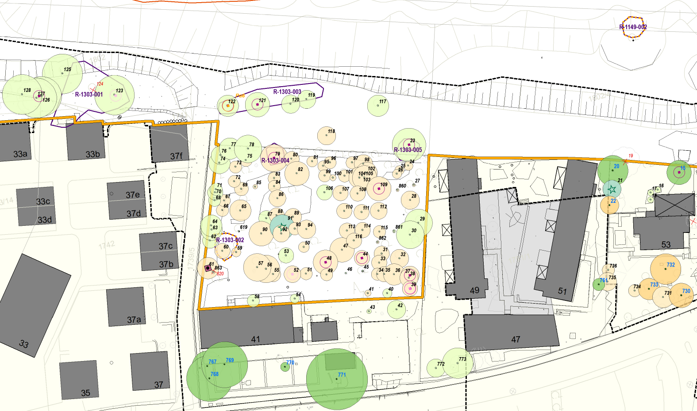
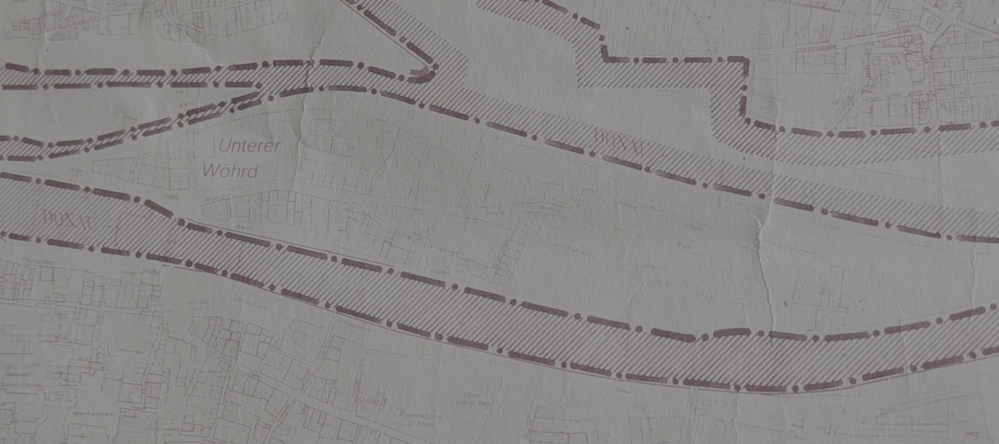

# Zweite Ergänzung unserer Einwendungen – Geltungsbereich der Baumschutzverordnung auf dem Grundstück Wöhrdstraße 41

 

Martin Schwenzer · Stephanie Sabatier · Florian Gebauer 
Wöhrdstraße 41 · 93059 Regensburg

Stadt Regensburg 
Umweltamt – Planfeststellungsbehörde 
z. Hd. Frau Barbara Wittmann 
Bruderwöhrdstraße 15 b 
93055 Regensburg

**14. Oktober 2026**

---

## Zweite Ergänzung unserer Einwendungen im wasserrechtlichen Planfeststellungsverfahren gem. § 68 Abs. 1 i. V. m. § 67 Abs. 2 WHG – Hochwasserschutz an der Donau im Bereich „Unterer Wöhrd“, Stadt Regensburg – Abschnitt H

**(AZ.: 31.1.2. Pl-HWS-H/Unterer Wöhrd)**

**Bezug:** Unsere fristgerechten Einwendungen vom 14.01.2026 (Schwenzer/Sabatier, insbesondere Abschnitte 2.2, 4.4 und 4.10) und vom 12.01.2026 (Florian und Susanne Gebauer, insbesondere Abschnitte 5 und 9); Erörterungstermin vom 22.07.2026; Ergänzung Schwenzer/Sabatier vom 02.08.2026 (übermittelt am 06.08.2026); Vor-Ort-Besprechung mit dem Wasserwirtschaftsamt am 24.06.2026

---

 

Sehr geehrte Frau Wittmann,
sehr geehrte Damen und Herren,

wir ergänzen unsere Einwendungen um eine Tatsache, die uns erst am 29.09.2026 bekannt geworden ist. Diese Ergänzung reichen wir gemeinsam ein; für die Einwendung Schwenzer/Sabatier ist sie nach der Ergänzung vom 02.08.2026 die zweite, für die Einwendung Gebauer die erste. Die Regierung der Oberpfalz hat dem Einwender Nils Deichner auf seine Bitte mit E-Mail vom 29.09.2026 die **Stellungnahme des Umweltamts der Stadt Regensburg als untere Naturschutzbehörde vom 11.09.2026 (Az. 31.2 Pö / HWS H Baumschutz)** zur Abgrenzung des Geltungsbereichs der Baumschutzverordnung im Vorhabensbereich übersandt, mit der **Telefonnotiz vom 25.04.2023** als Anlage (**Anlage 1**). Aus beiden Dokumenten ergibt sich erstmals, wie die Grenze des Baumschutzes auf unserem Grundstück zustande gekommen ist; ihr Verlauf war in Anlage D 7.1 der Planunterlagen ohne Begründung dargestellt. Der Gegenstand bezieht sich auf die Schutzgüter nach § 2 Abs. 1 UVPG und ist damit nach der Bekanntmachung vom 17.10.2025 vom Einwendungsausschluss ausgenommen; für die Umweltverträglichkeitsprüfung gilt zudem das Aktualitätsgebot des § 25 Abs. 3 UVPG.

Beim Erörterungstermin haben wir um Übersendung der Niederschrift gebeten (Art. 73 Abs. 6 Satz 6 i. V. m. Art. 68 Abs. 4 BayVwVfG); sie wurde uns zugesagt, liegt uns aber bislang nicht vor.

---

## 1. Neue Tatsache: Wie die Grenze des Baumschutzes auf unserem Grundstück gezogen wurde

**a) Die Grenze wurde von der Landschaftsarchitektin des Vorhabensträgers gezeichnet.** Die Baumschutzverordnung der Stadt Regensburg in der Fassung vom 09.01.2023 (nachfolgend „BSchV“) gilt für Bäume „innerhalb der im Zusammenhang bebauten Ortsteile“ (§ 1 Abs. 1). Für das Vorhaben wurde dieser Geltungsbereich projektbezogen als Linie festgelegt. Die Telefonnotiz des Planungsbüros bgmr Landschaftsarchitekten vom 25.04.2023 hält dazu fest: „Da die neuen Grenzen nicht zeichnerisch definiert sind (**müssten Bauordnung und UA festlegen**), haben Frau Dr. Pöhler und Frau Hain diese telefonisch abgestimmt“ und: „**Frau Hain zeichnet die Grenze** nach telefonischer Absprache und stuft die Bäume des Baumkatasters neu nach BaumSchVO ein.“ Die Legende des Baumkataster-Plans (Anlage D 7.1 der Planunterlagen) bezeichnet die Linie dementsprechend als „digitalisierter **Abgrenzungsvorschlag** nach telefonischer Abstimmung im Umweltamt der Stadt Regensburg am 25.04.2023“. Die Planerin des Vorhabensträgers hat damit die Grenze desjenigen Schutzregimes gezeichnet, dem das eigene Vorhaben unterliegt.

**b) Das Bauordnungsamt, das nach der Telefonnotiz mitfestlegen müsste, hat die Grenze nicht festgelegt.** Die Abgrenzung des im Zusammenhang bebauten Ortsteils ist eine bauplanungsrechtliche Frage (§ 34 BauGB); die Telefonnotiz selbst hält fest, dass die neuen Grenzen „Bauordnung und UA festlegen“ müssten. Die Stellungnahme vom 11.09.2026 bestätigt, dass Bauordnungsamt und Stadtplanungsamt nicht entschieden haben: „Im Planungsprozess wurde die Grenzziehung mit den genannten Ämtern diskutiert, die Entscheidung oblag dem Umweltamt, als für den Vollzug der Baumschutzverordnung zuständigen Stelle.“ Eine schriftliche, abschnitts- oder standortbezogene Begründung hält das Umweltamt nicht für erforderlich (Antwort 8: „Nein“), eine Überarbeitung von Baumkataster und Umweltunterlagen ebenfalls nicht (Antwort 9: „Nein“), Auswirkungen auf das Planfeststellungsverfahren sieht es keine (Antwort 10: „Keine“). Für die Bestimmtheit des Geltungsbereichs beruft sich die Stellungnahme auf den Beschluss des Bayerischen Verwaltungsgerichtshofs vom 08.03.2016 (14 ZB 15.1373). Die Bestimmtheit der Verordnung stellen wir nicht in Frage. In jenem Verfahren hatte die Beklagte vorgetragen, der Geltungsbereich lasse sich „anhand objektiver Kriterien, nämlich der Bebauungspläne bzw. der im Rahmen des § 34 BauGB angewendeten Abgrenzungskriterien, zweifelsfrei feststellen“. Hier geht es nicht um die Bestimmtheit der Norm, sondern um ihre Anwendung auf konkrete Bäume, über die der Planfeststellungsbeschluss entscheidet (§ 6 Abs. 3 BSchV); diese Anwendung ist nicht dokumentiert. Als Unterlage zur Grenzziehung legt die Stellungnahme allein die Telefonnotiz des Planungsbüros vor; die „Abstimmungen vor Ort und per E-Mail und Besprechungen“, die ihr vorausgegangen sein sollen (Antwort 2), werden weder datiert noch vorgelegt.

**c) Auf unserem Grundstück verläuft die Grenze des Baumschutzes entlang der Achse der geplanten Hochwasserschutzmauer.** Die Telefonnotiz nimmt vom Innenbereich ausdrücklich den „Obstgarten Wöhrdstr. 41 entlang der nördlichen Hausgrenze“ aus. Der Erläuterungsbericht (Anlage A, S. 34) legt die Mauer „in Achse der Nordfassade des Gebäudes“. Im Baumkataster-Plan D 7.1 verläuft die Linie des Geltungsbereichs bei den Nachbargrundstücken Wöhrdstraße 33a–37f und 49–53 an der nördlichen Grenze der Hausgärten; nur um unseren Garten macht sie eine rechteckige Ausbuchtung nach Süden bis an die Nordwand des Hauses (Abbildung 1). Alles nördlich der Mauerachse, also genau das Baufeld für Mauer, Arbeitsebene für die Bohrungen und Untergrundabdichtung, liegt damit außerhalb der Baumschutzverordnung. Sämtliche unter Nr. 24–116 geführten Bäume unseres Grundstücks tragen den Schutzstatus „nein“ (Anlage D 7.2), auch die beiden, die der Landschaftspflegerische Begleitplan (nachfolgend „LBP“, Anlage D 2.5, Tab. 5e) dem Innenbereich zurechnet (Sommerlinde Nr. 42, Eberesche Nr. 43), weil ihr Katasterumfang unter 100 cm liegt.

<figure style="margin: 1em 0;">

<figcaption style="font-size: 10pt; margin-top: 4px;"><strong>Abbildung 1:</strong> Ausschnitt aus Anlage D 7.1 (Baumkataster-Plan). Orange: „Geltungsbereich Baumschutzverordnung Regensburg 2023 im Vorhabensbereich“. Bei den Nachbargrundstücken verläuft die Linie an der Nordgrenze der Gärten, um den Obstgarten Wöhrdstraße 41 springt sie bis an die Nordfassade des Hauses zurück.</figcaption>
</figure>

**d) Das erklärt den Befund unserer Einwendungen.** Wir hatten in beiden Einwendungen gerügt (Schwenzer/Sabatier, Abschnitt 2.2; Gebauer, Abschnitt 9 mit Anlagen 2 und 3), dass alle Bäume auf unserem Grundstück als „nicht geschützt“ geführt werden, obwohl viele von ihnen den Stammumfang von 100 cm überschreiten. Die Ursache ist nach den jetzt vorliegenden Unterlagen nicht allein ein Mess- oder Übertragungsfehler, sondern vor allem die beschriebene Grenzziehung. Unsere Rüge trifft damit nicht nur einzelne Katasterwerte, sondern die Tatsachengrundlage der gesamten Bewertung auf dem Grundstück.

**e) Bis 2023 lag das Grundstück im Geltungsbereich.** Nach der Stellungnahme legte die bis 2023 geltende Fassung der Baumschutzverordnung den Geltungsbereich „durch eine Karte aus dem Jahr 1993“ fest. Der Einwender Nils Deichner hat diese Karte am 26.08.2026 beim Umweltamt eingesehen und fotografiert (Abbildung 2; Übersicht in **Anlage 2**): Ausgenommen sind dort nur die beiden Donauarme; der Untere Wöhrd liegt als ganze Insel im Geltungsbereich, die Linie folgt dem Ufer und nicht den Haus- und Gartengrenzen. Unser Obstgarten lag danach bis 2023 im Geltungsbereich. Die Neufassung sollte nach der in der Stellungnahme zitierten Beschlussvorlage vom 30.11.2022 den Schutz der Bäume „auf den gesamten bebauten Stadtbereich“ ausdehnen und den Geltungsbereich „mitwachsen“ lassen; auf dem Unteren Wöhrd nimmt die projektbezogene Linie Flächen heraus, die nach der Karte von 1993 im Geltungsbereich lagen. Anlage D 7.0 (S. 4) hält selbst fest, dass die Verordnung 2023 „Änderungen des Schutzstatus und des Geltungsbereichs“ mit sich bringt.

<figure style="margin: 1em 0;">

<figcaption style="font-size: 10pt; margin-top: 4px;"><strong>Abbildung 2:</strong> Karte zum Geltungsbereich der Baumschutzverordnung 1993, Ausschnitt Unterer Wöhrd (Foto: Nils Deichner, Umweltamt der Stadt Regensburg, 26.08.2026; Übersicht in Anlage 2).</figcaption>
</figure>

---

## 2. Was die Grenzziehung für unser Grundstück bewirkt

**a) Ersatzpflanzungen nach der Baumschutzverordnung: null statt dreizehn bis siebzehn.** Auf unserem Grundstück sind nach dem LBP (Anlage D 2.5, Tab. 5b und 5e) 23 Bäume zu fällen, 21 davon in der „Streuobstwiese Außenbereich“. Verlust und Ersatzbedarf nach Baumschutzverordnung sind dafür jeweils mit **0** angesetzt. Nach den eigenen Katasterwerten (Anlage D 7.2) liegen fünf dieser Bäume über der Schutzschwelle des § 1 Abs. 2 BSchV: Stieleiche Nr. 29 (130 cm), Walnuss Nr. 30 (175 cm), Zwetschge Nr. 37 (115 cm, Höhlenbaum), Kultur-Birne Nr. 52 (120 cm, Initialhöhle) und Mirabelle Nr. 61 (mehrstämmig 70 + 65 cm). Lägen sie im Geltungsbereich, könnten nach der Staffel des § 7 Abs. 2 Buchst. a BSchV, die der LBP für geschützte Bäume durchgängig anwendet, **13 Ersatzbäume** gefordert werden; mit dem Kultur-Apfel Nr. 39 (Mulmhöhle; Kataster 95 cm, nach unserer Messung 103 cm, Einwendung Schwenzer/Sabatier, Abschnitt 2.2) wären es 15. Die Sommerlinde Nr. 42 steht nach Anlage D 7.1 südlich der Linie und wird vom LBP dem Innenbereich zugerechnet (Tab. 5e: zwei Fällungen im „strukturreichen Garten, Innenbereich“); mit den von uns gemessenen 110 cm statt der im Kataster geführten 75 cm (Einwendungen, Abschnitte 2.2 bzw. 9) ist sie bereits heute geschützt, und für sie könnten zwei weitere Ersatzbäume I. Wuchsordnung gefordert werden, zusammen 17. Stattdessen werden die 23 Fällungen über die Flächenbewertung nach der Bayerischen Kompensationsverordnung abgegolten und mit 21 Neupflanzungen zur Wiederherstellung von Obstwiese und Garten verrechnet, davon 19 Bäume II. Wuchsordnung, ohne Einzelbaumbewertung der Eiche und der Walnuss.

**b) Die Alternativenprüfung je Baum entfällt.** Für geschützte Bäume darf eine Genehmigung nach § 5 Nr. 1 BSchV nur erteilt werden, wenn das Vorhaben ohne die Entfernung „nicht möglich ist und **zumutbare Alternativen nicht zur Verfügung stehen**“. Im Planfeststellungsverfahren wird diese Genehmigung durch den Planfeststellungsbeschluss ersetzt; „sie darf nur erteilt werden, wenn die Voraussetzungen des § 5 vorliegen“ (§ 6 Abs. 3 BSchV, Art. 75 Abs. 1 Satz 1 BayVwVfG). Für Bäume im Geltungsbereich muss die Planfeststellungsbehörde also für jeden einzelnen Baum prüfen, ob eine zumutbare Umplanung möglich ist. Stützt die Behörde die Ersetzung auf § 5 Nr. 5 BSchV (überwiegende Gründe des allgemeinen Wohls), ändert das nichts: Ob das Allgemeinwohl die Fällung eines geschützten Baumes erfordert, lässt sich ohne Prüfung zumutbarer Alternativen nicht beantworten (vgl. auch § 15 Abs. 1 BNatSchG). Genau diese Prüfung, ein früheres Ende der Untergrundabdichtung, haben wir in unseren Einwendungen (Schwenzer/Sabatier, Abschnitt 4.4; Gebauer, Abschnitt 5), im Erörterungstermin und in der Vor-Ort-Besprechung mit dem Wasserwirtschaftsamt vom 24.06.2026 verlangt. Mit der Grenzziehung entlang der Mauerachse ist sie für die Bäume, die der Mauer weichen sollen, von vornherein ausgeschlossen.

**c) Die Planunterlagen behandeln den Obstgarten je nach Argumentationsbedarf unterschiedlich.** Der LBP führt die Einstufung des Obstgartens als Außenbereich als **Vorteil** der Vorzugsvariante an („Erhalt/langfristige Sicherung der Streuobstwiese als Teil des städtebaulichen Außenbereichs“, Anlage D 2.0, S. 57 f.) und verwirft die Variante einer Mauer an der nördlichen Grundstücksgrenze unter anderem deshalb, weil der Obstgarten dann „Teil des Siedlungsbereichs“ würde. Dieselbe Einstufung nimmt zugleich den Bäumen, die für diese Vorzugsvariante gefällt werden, den Schutz. Die Umweltverträglichkeitsstudie hält zum Prognose-Nullfall fest, dass ohne das Vorhaben „eine Siedlungsentwicklung im Obstgartenareal (PA 1) gemäß Flächennutzungsplan … nicht mehr ganz ausgeschlossen“ wäre (Anlage D 1.0, S. 127). Die Biotopkartierung beschreibt den „Garten hinter dem Haus“ mit seinem „alten Obstbaumbestand“, „am nördlichen sowie westlichen Rand von einer alten Weißdornhecke umgeben“ (Anlage D 6.0, S. 6). Nach der Rechtsprechung endet der Bebauungszusammenhang zwar regelmäßig am letzten Baukörper; hausnahe, typische Hausgärten werden ihm aber zugerechnet (vgl. BayVGH, Beschluss vom 18.09.2024 – 1 ZB 23.2080). So ist die Linie bei den Nachbargrundstücken gezogen, an der Nordgrenze der Hausgärten. Auf Wöhrdstraße 41 lässt sie nicht einmal den hausnahen Streifen im Innenbereich, in dem die Mauer stehen soll.

**d) Die behauptete Ortseinsicht ist nicht belegt.** Nach der Stellungnahme wurden die tatsächlichen Verhältnisse „in uneindeutigen Fällen“ geprüft, „sowohl hinsichtlich der Aktenlage als auch durch konkrete Ortseinsichten (z. B. ‚Jacobi-Areal‘ oder Grundstück Wöhrdstraße 41)“ (Antwort 4). Datum, Teilnehmer und Vermerk werden nicht genannt. Uns als Bewohnerinnen und Bewohnern des Anwesens, zum Teil seit fast 30 Jahren, ist eine Ortseinsicht des Umweltamts zur Grenze des Baumschutzes nicht bekannt; eine Anfrage hierzu hat es nicht gegeben. Das Umweltamt stuft den Fall damit selbst als „uneindeutig“ ein, ohne die Prüfung zu dokumentieren.

---

## 3. Weitere Widersprüche in der Anwendung der Grenze

Der Einwender Nils Deichner hat der Regierung der Oberpfalz mit Schreiben vom 30.09.2026 im Einzelnen dargelegt, dass die Stellungnahme vom 11.09.2026 in mehreren Punkten nicht mit den ausgelegten Planunterlagen übereinstimmt. Wir schließen uns dem an und heben hervor, was unser Grundstück unmittelbar betrifft:

**a) Hochufer ist nicht gleich Hochufer.** Die Telefonnotiz ordnet das „Hochufer Kastanienallee“ (PA 5) dem Innenbereich zu, das Hochufer in PA 1 „nördlich der Bau- und Gartengrenze“, also vor unserem Grundstück und den Nachbargrundstücken, dagegen dem Außenbereich. Ein Kriterium für diese unterschiedliche Behandlung nennen weder die Planunterlagen noch die Stellungnahme (Antwort 6 auf die Frage nach einheitlicher und widerspruchsfreier Anwendung: „Aus Sicht des Umweltamtes: Ja“).

**b) Die Linie gilt starr, wo sie Schutz nimmt, und elastisch, wo Ersatz angerechnet wird.** Die positive Bilanz nach Baumschutzverordnung von 24 Bäumen I. Wuchsordnung (Anlage D 2.0, S. 69) kommt nach Tab. 5e nur durch die Anrechnung von 32 Neupflanzungen I. Wuchsordnung in PA 10 zustande. PA 10 ist nach der Telefonnotiz Außenbereich. § 7 Abs. 2 BSchV sieht Ersatz „auf einem Grundstück im Geltungsbereich dieser Verordnung“ vor. Ohne PA 10 ergäbe sich ein Defizit von 8 Bäumen I. Wuchsordnung. Zugleich wurden Neupflanzungen „nach Rücksprache im Umweltamt“ auch dann als geschützte Ersatzpflanzungen eingestuft, „auch wenn diese sich außerhalb der im Zusammenhang bebauten Ortsteile befinden“ (Anlage D 7.0, S. 4).

**c) Die Katasterwerte in Grenznähe sind nicht belastbar.** Unmittelbar westlich unseres Grundstücks, auf dem Hochufer vor den Häusern Wöhrdstraße 33a/33b, sollen vier Altbäume des Stadtbiotops R-1303-001 baubedingt gefällt werden (Anlage A, S. 78; Anlage D 2.0, S. 67). Das Kataster führt sie als „nicht geschützt“ mit Stammumfängen von 300 cm (Spitzahorn Nr. 123), 100 cm (Robinie Nr. 126), 400 cm (Robinie Nr. 127) und 300 cm (Robinie Nr. 128), jeweils mit dem Vermerk „V-Daten angepasst“ und mit identischem Kronendurchmesser (13 m). Unsere Nachmessung am 01.10.2026 in 1 m Höhe ergab für den Spitzahorn mehr als 300 cm und für die drei Robinien näherungsweise 100, 200 und 240 cm. Die Katasterwerte sind dort auf volle Meter gerundet und mit dem Vermerk „V-Daten angepasst“ versehen; mit unseren Messungen stimmen sie nicht überein. Das bestätigt die Kataster-Rügen in beiden Einwendungen und unser im Erörterungstermin vorgetragenes Anliegen einer Neubegehung und Korrektur des Baumkatasters. Baumkataster-Erläuterung D 7.0 (S. 5) hält im Übrigen selbst fest: „Je nach Verfahrensdauer kann damit ggf. eine erneute Prüfung des Schutzstatus von Bäumen im Eingriffsbereich notwendig werden.“

**d) Technische Alternativen zum Baumerhalt gibt es.** Nach unserer Kenntnis wird für die genannten vier Altbäume vor Wöhrdstraße 33a/33b ein aufwendigeres Bauverfahren erwogen, um sie erhalten zu können. Wir begrüßen das ausdrücklich und bitten um Auskunft, welches Verfahren geprüft wird. Wenn eine solche Bauweise für vier nach den Planunterlagen ungeschützte Bäume am Ufer in Betracht kommt, ist sie für die Bäume auf Wöhrdstraße 41 erst recht eine „zumutbare Alternative“ im Sinne des § 5 Nr. 1 BSchV. Wir bitten um ihre Prüfung auch für unser Grundstück.

---

## 4. Anträge

Wir beantragen zur Sachverhaltsaufklärung (Art. 24 BayVwVfG) und ergänzend zu unseren Einwendungen (Schwenzer/Sabatier, Abschnitte 2.2, 4.4 und 4.10; Gebauer, Abschnitte 5 und 9) sowie zu den im Erörterungstermin vorgetragenen Anliegen zu Baumkataster, Ersatzpflanzungen und Verlauf der Untergrundabdichtung:

1. **Förmliche Feststellung des Geltungsbereichs.** Die Planfeststellungsbehörde veranlasst, dass der räumliche Geltungsbereich der Baumschutzverordnung im Vorhabensbereich unter Beteiligung des Bauordnungsamts schriftlich und mit Karte festgestellt und abschnittsweise begründet wird. Für das Grundstück Wöhrdstraße 41 ist standortbezogen darzulegen, warum der Bebauungszusammenhang an der Nordfassade des Wohnhauses enden soll, obwohl hausnahe, eingefriedete und bewirtschaftete Gartenflächen vorliegen und die Linie bei den Nachbargrundstücken an der Nordgrenze der Gärten verläuft; ferner, nach welchem Kriterium das Hochufer an der Kastanienallee dem Innenbereich, das Hochufer in PA 1 dem Außenbereich zugeordnet wurde.
2. **Vorlage der Unterlagen zur Grenzziehung.** Vorzulegen sind die der Telefonabstimmung vom 25.04.2023 vorausgegangenen Abstimmungen, E-Mails, Besprechungsvermerke und Kartenentwürfe sowie der Nachweis der in der Stellungnahme behaupteten Ortseinsicht auf dem Grundstück Wöhrdstraße 41 (Datum, Teilnehmer, Vermerk). Hilfsweise beantragen wir insoweit Akteneinsicht (Art. 29 BayVwVfG).
3. **Vorlage der früheren Geltungsbereichskarte und des alten Schutzstatus.** Vorzulegen ist die Karte von 1993 zur Baumschutzverordnung in der Fassung von 2004 (Abschnitt 1 e) sowie für alle Bäume des Vorhabens der Schutzstatus nach der früheren Fassung. Die Datenbank des Baumkatasters enthält diesen Status bereits (Anlage D 7.0, S. 5: Schutzstatus gemäß der alten Baumschutzverordnung, ja/nein); in Anlage D 7.2 ist er nicht abgedruckt.
4. **Neuberechnung der Bilanz nach Baumschutzverordnung** (Anlage D 2.5, Tab. 5e): unter Einbeziehung der Bäume des Grundstücks Wöhrdstraße 41, ohne Anrechnung von Ersatzpflanzungen außerhalb des Geltungsbereichs (PA 10) und mit Einzelbaumbewertung der Stieleiche Nr. 29 und der Walnuss Nr. 30.
5. **Prüfung der Genehmigungsvoraussetzungen des § 5 BSchV für jeden betroffenen Baum** auf dem Grundstück Wöhrdstraße 41, einschließlich der Alternativen eines früheren Endes der Untergrundabdichtung und des unter 3 d genannten Bauverfahrens, sowie Vorlage einer aktualisierten Fällliste für die in der Vor-Ort-Besprechung vom 24.06.2026 mit dem Wasserwirtschaftsamt besprochene geänderte Linienführung.
6. **Klarstellung im Planfeststellungsbeschluss**, für welche Bäume er die Genehmigung nach der Baumschutzverordnung ersetzt (§ 6 Abs. 3 BSchV, Art. 75 Abs. 1 BayVwVfG), nach der Sach- und Rechtslage im Zeitpunkt seines Erlasses.
7. **Eigenständige Prüfung durch die Planfeststellungsbehörde.** Die Grenzfrage ist von der Planfeststellungsbehörde selbst zu prüfen und zu entscheiden. Die Stellungnahme vom 11.09.2026 wurde vom Umweltamt als untere Naturschutzbehörde (Amt 31.2) abgegeben; Planfeststellungsbehörde ist nach der Bekanntmachung vom 17.10.2025 dasselbe Umweltamt als untere Wasserrechtsbehörde. Die Stellungnahme beantwortet die Frage nach den Auswirkungen auf das Planfeststellungsverfahren mit „Keine“ und verweist bei der Frage nach irreversiblen Maßnahmen darauf, „nicht der Vorhabenträger der Maßnahme“ zu sein. Wir bitten um Bestätigung, dass die Vorabstimmung zwischen Amt 31.2 und dem Vorhabensträger die Entscheidung der Planfeststellungsbehörde nicht vorwegnimmt.

---

## 5. Verfahrensbitten

1. Wir bitten um **Eingangsbestätigung** für diese Ergänzung und, da sie bislang aussteht, auch für die Ergänzung von Martin Schwenzer und Stephanie Sabatier vom 02.08.2026 (übermittelt am 06.08.2026 mit fünf Anlagen; Nachfrage vom 06.09.2026).
2. Wir bitten um Übersendung der **Niederschrift über den Erörterungstermin** vom 22.07.2026 (Art. 73 Abs. 6 Satz 6 i. V. m. Art. 68 Abs. 4 BayVwVfG), die uns im Termin auf unsere Bitte zugesagt wurde.
3. Wir bitten, diese Ergänzung in die zusammenfassende Darstellung nach § 24 UVPG und in die Abwägung einzubeziehen und uns das Ergebnis der unter Abschnitt 4 Nr. 1 beantragten Feststellung vor der Entscheidung mitzuteilen.
4. Wir bitten, uns wie bereits im Erörterungstermin und in der Ergänzung vom 02.08.2026 erbeten über den weiteren Verfahrensgang individuell zu informieren und die Entscheidung individuell zuzustellen.

Für Rückfragen und für einen gemeinsamen Ortstermin auf dem Grundstück stehen wir jederzeit zur Verfügung.

Mit freundlichen Grüßen

  

Martin Schwenzer &nbsp;&nbsp;&nbsp;&nbsp;&nbsp;&nbsp; Stephanie Sabatier &nbsp;&nbsp;&nbsp;&nbsp;&nbsp;&nbsp; Florian Gebauer

Wöhrdstraße 41, 93059 Regensburg

## Anlagen

1. Stellungnahme des Umweltamts der Stadt Regensburg (Amt 31/31.2) vom 11.09.2026 an die Regierung der Oberpfalz, SG 55.1, Az. 31.2 Pö / HWS H Baumschutz, mit Anlage: Telefonnotiz bgmr Landschaftsarchitekten vom 25.04.2023 (6 Seiten)
2. Foto der Karte zum Geltungsbereich der Baumschutzverordnung 1993 (Übersicht), aufgenommen von Nils Deichner beim Umweltamt der Stadt Regensburg am 26.08.2026 (1 Seite)

Abbildungen im Text: 1 Ausschnitt aus Anlage D 7.1 der Planunterlagen (Baumkataster-Plan, Geltungsbereich Baumschutzverordnung 2023); 2 Ausschnitt der Karte zur Baumschutzverordnung 1993 (Foto Nils Deichner, 26.08.2026).

**Nachrichtlich:** Regierung der Oberpfalz, Sachgebiet 55.1 – Rechtsfragen Umwelt (Bezug: Schreiben an Herrn Nils Deichner vom 21.09.2026); Herr Nils Deichner, Wöhrdstraße 1, 93059 Regensburg
