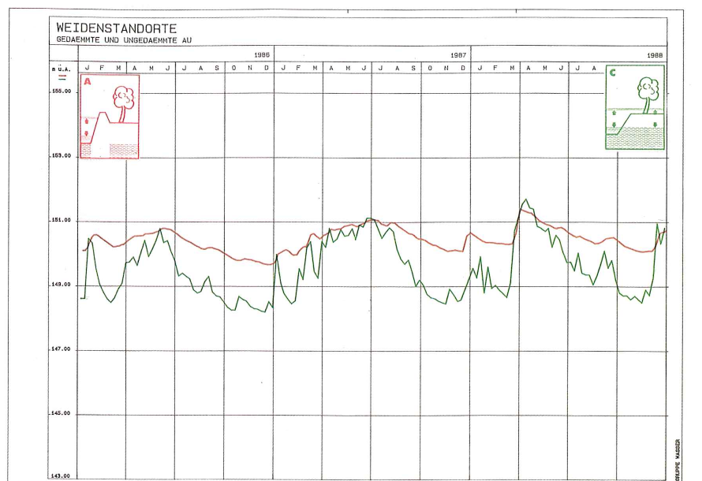
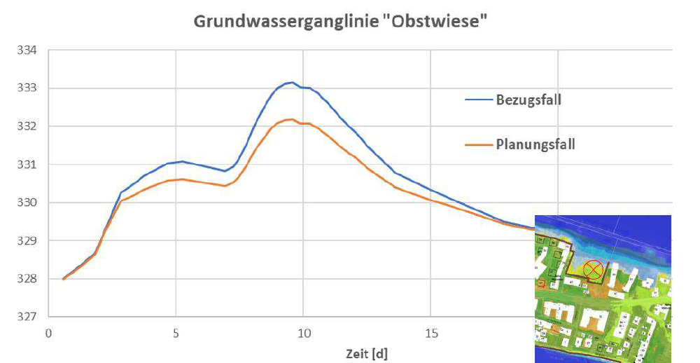

# Dritte Ergänzung unserer Einwendungen – Dauerwirkung der Untergrundabdichtung auf Grundwasserdynamik und Baumbestand

 

Martin Schwenzer · Stephanie Sabatier 
Wöhrdstraße 41 · 93059 Regensburg

Stadt Regensburg 
Umweltamt – Planfeststellungsbehörde 
z. Hd. Frau Barbara Wittmann 
Bruderwöhrdstraße 15 b 
93055 Regensburg

**15. Oktober 2026**

---

## Dritte Ergänzung unserer Einwendungen im wasserrechtlichen Planfeststellungsverfahren gem. § 68 Abs. 1 i. V. m. § 67 Abs. 2 WHG – Hochwasserschutz an der Donau im Bereich „Unterer Wöhrd“, Stadt Regensburg – Abschnitt H

**(AZ.: 31.1.2. Pl-HWS-H/Unterer Wöhrd)**

**Bezug:** Unsere fristgerechte Einwendung vom 14.01.2026 (insbesondere Abschnitt 4.5); Erörterungstermin vom 22.07.2026; Ergänzung vom 02.08.2026 (übermittelt am 06.08.2026); zweite Ergänzung vom 14.10.2026 (gemeinsam mit Florian Gebauer)

---

 

Sehr geehrte Frau Wittmann,
sehr geehrte Damen und Herren,

wir ergänzen unsere Einwendungen um einen Gesichtspunkt, für den uns erst jetzt ein fachlicher Beleg vorliegt: die **dauerhafte Wirkung der Untergrundabdichtung auf die Grundwasserdynamik und damit auf den Baumbestand** innerhalb der Schutzlinie und in deren Umfeld. Die Planunterlagen stufen diese Wirkung als unerheblich ein. Eine vergleichende Untersuchung der Stadt Wien an Auwaldstandorten, die seit rund hundert Jahren durch einen Hochwasserschutzdamm vom Strom getrennt sind, belegt das Gegenteil (**Anlage 1**). Der Gegenstand betrifft die Schutzgüter Pflanzen, Boden und Wasser nach § 2 Abs. 1 UVPG und ist damit nach der Bekanntmachung vom 17.10.2025 vom Einwendungsausschluss ausgenommen; für die Umweltverträglichkeitsprüfung gilt zudem das Aktualitätsgebot des § 25 Abs. 3 UVPG. In unserer Einwendung (Abschnitt 4.5) hatten wir die dauerhafte Veränderung des hydrogeologischen Systems durch die Untergrundabdichtung gerügt; im Erörterungstermin haben wir beantragt, das Grundwassermodell um Niedrigwasser-Szenarien zu ergänzen und die Folgen dauerhaft veränderter Grundwasserstände auch für die Vegetation zu bewerten. Beides greifen wir hier auf.

---

## 1. Wie die Planunterlagen die Dauerwirkung bewerten

**a) Das Grundwassermodell bewertet die Dauerwirkung allein am Mittelwasser.** Die Untergrundabdichtung wird „bis zum Grundwasserstauer in Tiefen bis zu 20 m unter Gelände“ geführt (Anlage A, S. 21). Das Fachgutachten zum Grundwassermodell (Anlage F 3.2, Teil 3) hat vier Rechenläufe durchgeführt: Mittel- und Hochwasser (HQ100), jeweils im Bezugs- und im Planungszustand; „dauerhafte Auswirkungen“ wurden „stationär“ bei „mittleren Verhältnissen“ untersucht (ebd., S. 29, 40). Das Ergebnis lautet: „Die dauerhaften Änderungen der Grundwasserverhältnisse durch die geplante Untergrundabdichtung sind unerheblich (Änderung der Grundwasserstände im einstelligen Zentimeterbereich, bei einer natürlichen Schwankungsbreite im Meterbereich)“ (ebd., S. 43; ebenso Anlage A, S. 75). Zugleich hält das Gutachten fest, dass sich „durch die Behinderung des Grundwasseraustausches mit der Donau … der Grundwasserumsatz … reduziert“, „besonders ausgeprägt … im westlichen Bereich der Insel und an einspringenden Ecken der Untergrundabdichtung“, wo bei länger gleichbleibendem Donauwasserstand „nur noch ein kleiner Grundwasserumsatz“ stattfindet (ebd., S. 40 f.). Dass es sich nicht um eine „dauerhafte Stagnation“ handle, begründet das Gutachten mit den schwankenden Wasserständen der Donau: Auch im Planungsfall folge das Grundwasser der Hochwasserwelle, „es stellt sich nur eine Dämpfung in der Amplitude ein“ (ebd., S. 41). Für die Obstwiese nördlich der Untergrundabdichtung, also unseren Obstgarten, zeigt Abbildung 13 des Gutachtens diese Dämpfung: Der Scheitel des Grundwasserstands beim Bemessungshochwasser liegt im Planungsfall rund 0,9 m niedriger als im Bezugsfall (Abbildung 2 dieses Schreibens).

**b) Die Umweltverträglichkeitsstudie erklärt die Dämpfung für unschädlich, weil die Bäume Schwankungen gewöhnt seien.** Für den Baumbestand innerhalb der Untergrundabdichtung führt die UVS aus, es komme „letztendlich nur zu einer Dämpfung des maximalen GW-Anstiegs über einen Zeitraum von 14–16 Tagen“; statt eines Anstiegs bis oder über Gelände würden die Grundwasserstände „kurzzeitig auf ein Niveau von ca. −0,5 bis −2,8 m unter Gelände abgesenkt“, „sodass keine relevanten Verschlechterungen für Baumbestände innerhalb der Untergrundabdichtung zu erwarten sind. Der Baumbestand auf der Insel ist an viel stärkere Grundwasserspiegelschwankungen bzw. Überflutungen gewöhnt.“ Im selben Absatz heißt es: „Zudem besteht bei künftig trockeneren Bodenverhältnissen die Möglichkeit, nachteilige Wirkungen durch Bewässerungsmaßnahmen zu vermeiden. Nasseren, stagnierenden Verhältnissen könnte bei Bedarf durch eine Anpassung der Vegetationsstruktur begegnet werden“ (Anlage D 1.0, S. 132; ebenso S. 209). Den Obstgarten Wöhrdstraße 41 zählt die UVS dort ausdrücklich zu den „wertgebenden grundwasserabhängigen Landökosystemen“. Unter den Überwachungsmaßnahmen empfiehlt sie, „die Entwicklung von Gehölzbeständen innerhalb der Untergrundabdichtung und außerhalb der Untergrundabdichtung im Bereich Wald am Jakobigelände PA 2 und Obstgarten Wöhrdstr. 41, PA 1 zu beobachten. Sollten sich Auffälligkeiten an diesen Gehölzen zeigen, wie z. B. zunehmende Krankheiten oder gar Absterben, dann könnten bei Bedarf Anpassungen vorgenommen [werden], wie z. B. das Pflanzen von Arten, die mit den Veränderungen des Bodenwasserhaushalts besser zurechtkommen“ (ebd., S. 233; ebenso S. 251).

**c) Befund.** Die Planunterlagen beschreiben die Wirkung zutreffend (Ausfall der Überflutung, Kappung der Grundwasserspitzen, verringerter Grundwasserumsatz, Veränderung des Bodenwasserhaushalts), bewerten sie aber am Mittelwert und erklären den Wegfall der Extreme für unschädlich, ohne das fachlich zu belegen. Ein fachlicher Beleg liegt vor, und er kommt zum gegenteiligen Ergebnis. Dass die UVS selbst Bewässerung, einen Artenwechsel und die Beobachtung auf „Absterben“ in Aussicht stellt, zeigt, dass sie die Veränderung des Standorts erwartet.

---

## 2. Die Untersuchung der Stadt Wien: Gedämmte Au – Geflutete Au

**a) Gegenstand und Methode.** Die Stadt Wien (Magistratsabteilung 49, Forstamt) hat 1990 untersuchen lassen, wie sich die Abdämmung von Auwaldstandorten durch den Hochwasserschutzdamm auswirkt. Verglichen wurden je zwei Standorte der Silberweide und der Weißpappel in der Unteren Lobau, die seit Errichtung des Hubertusdamms Ende des 19. Jahrhunderts vom Strom getrennt ist, mit gleichartigen Standorten der weiterhin überfluteten Mannswörther Au am gegenüberliegenden Ufer. Beteiligt waren die Institute für Forstökologie und für forstliche Ertragslehre der Universität für Bodenkultur Wien sowie ein hydrologisches Ingenieurbüro; erhoben wurden Grundwasserganglinien 1956–1988, Bohrprofile, Profilgruben mit Wurzelzählung, Bodenwasserspannung, Boden- und Streuanalysen sowie Zuwachsmessungen an über 2.000 Probestämmen (Haubenberger/Weidinger 1990, S. 5, 19, 21 ff., 30 ff., 44; Nachdruck 2016 als Heft 41 der Wissenschaftlichen Reihe des Nationalparks Donau-Auen; Auszug als Anlage 1, Seitenangaben nach der gedruckten Zählung).

**b) Befunde.** Die Abdämmung hat die Grundwasserdynamik in der Lobau gedämpft, nicht beseitigt: Die Extremwerte der Grundwasseramplitude 1956–1988 betragen gedämmt 2,1 m (Weide) und 2,6 m (Pappel), geflutet 5,3 m und 5,8 m (Tab. 7, S. 24). Der Pappelstandort der gedämmten Au hat an 23 Tagen im Jahr Grundwasser in der durchwurzelbaren Deckschicht, der geflutete an 300 Tagen (Tab. 8, S. 24). Die Studie beschreibt den Mechanismus (S. 23): Durch die Abdämmung „entfallen die Überschwemmungen“, die Grundwasserschwankungen werden „sowohl in der Höhe als auch zeitlich gedämpft“, die periodische Durchlüftung des Bodens („Lungeneffekt“) fällt aus. Die Folgen sind „ein verminderter Abbau der organischen Substanz, die Freisetzung von Methan und Schwefelwasserstoff, eine erhöhte Mobilität von Eisen, Mangan und Phosphor … Reduktionserscheinungen … und die Ausbildung eines von den Auwaldpflanzen nicht mehr durchwurzelbaren Bodenhorizontes (Vergleyung)“. In der Lobau sind unterhalb 100 cm „kaum noch Feinwurzeln vorhanden“ (S. 32). Die Kohlenstoff- und Stickstoffvorräte des Bodens liegen in der gefluteten Au bei 165 bis 177 % der gedämmten (Tab. 16 und 17, S. 41). Die Silberweide braucht in der gedämmten Au „um bis zu 10 Jahre länger“ für dieselbe Höhe, die Stammzahlhaltung ist deutlich geringer, die Ausschlagfähigkeit lässt nach (S. 46). Der gedämmte Pappelstandort zeigt „eine starke Abhängigkeit vom Niederschlag“ und bei fehlendem Niederschlag „Trockenstreß für die Vegetation“ (S. 39); am gedämmten Weidenstandort verdrängt dauernd hoch anstehendes Grundwasser mit geringer Amplitude die Bodenluft (S. 39). Weide und Pappel verjüngen sich nicht mehr, weil die gereiften Böden ihren Samen keine Keimbedingungen bieten; der Bestand entwickelt sich „in Richtung Landwald“ (S. 13, 15). Das Fazit der Autoren: Die Unterschiede sind „zum Großteil auf die fehlenden Überflutungen und die eingeengte Schwankungsbreite des Grundwassers“ zurückzuführen (S. 43); dynamische Wasserverhältnisse sind für Erhalt und Wiederherstellung von Auwald „eine Grundvoraussetzung“ (S. 49).

<figure style="margin: 1em 0;">

<figcaption style="font-size: 10pt; margin-top: 4px;"><strong>Abbildung 1:</strong> Grundwasserganglinien 1986–1988 an den Weidenstandorten der gedämmten Au (rot, Untere Lobau) und der gefluteten Au (grün, Mannswörth). Aus Haubenberger/Weidinger 1990, Abb. 19, S. 29.</figcaption>
</figure>

**c) Übertragbarkeit.** Die Lobau ist ein geschlossener Auwald auf Feinsand über Kies, der Untere Wöhrd eine bebaute Insel mit Straßen-, Garten- und Uferbäumen; der Hubertusdamm ist ein Erddamm, die hier geplante Untergrundabdichtung eine Dichtwand. Der Mechanismus ist derselbe: Der Hochwasserschutz nimmt dem Standort die Überflutung und kappt die Grundwasserspitzen, der Mittelwasserstand bleibt nahezu unverändert. Genau diese Konstellation bewerten die Planunterlagen als unerheblich, und genau sie hat in der Lobau über Jahrzehnte zu Vergleyung, Nährstoffverarmung, Wuchsverlust und Ausfall der Verjüngung geführt. Dass der Grundwasserflurabstand auf dem Unteren Wöhrd bei Mittelwasser „in der Regel mindestens 3 m“ beträgt (Anlage D 1.0, S. 132), spricht nicht gegen die Übertragbarkeit: Die Studie zeigt, dass Auwaldbäume den Grundwasserkontakt über die periodischen Hochstände erhalten und tief wurzeln, solange dieser Kontakt besteht (S. 23, 32 f.). Wie rasch ein Bauwerk die Grundwasserdynamik dämpft, zeigt die Studie am Kraftwerk Greifenstein: Nach dem Einstau 1984 sank die mittlere Differenz zwischen höchstem und niedrigstem Grundwasserstand am Brunnen Wördern von 1,44 m auf 0,43 m (S. 25).

---

## 3. Was das für den Unteren Wöhrd bedeutet

**a) Innerhalb der Schutzlinie.** Für den gesamten Baumbestand innerhalb der Untergrundabdichtung entfallen mit dem Vorhaben die Überflutungen; die Grundwasserspitzen werden bei jedem Hochwasser, bei dem die Binnenentwässerung läuft, auf 0,5 bis 2,8 m unter Gelände gekappt (Anlage D 1.0, S. 132). Das ist, über die Lebensdauer des Bauwerks betrachtet, die Situation der Lobau. Welche Bäume das betrifft, sagen die Planunterlagen nicht; das Baumkataster (Anlage D 7) erfasst nur den potenziellen Eingriffsbereich (Anlage D 7.0, S. 5). Eine Bewertung nach Anzahl, Arten und Alter fehlt.

**b) Der Obstgarten Wöhrdstraße 41.** Die UVS stuft den Obstgarten als „wertgebendes grundwasserabhängiges Landökosystem“ ein und nimmt an, er bleibe „weiterhin direkt an die Hydrodynamik der Aue angebunden“ (Anlage D 1.0, S. 132). Abbildung 13 des Grundwassermodells zeigt für dieselbe Fläche eine Dämpfung des Hochwasserscheitels um rund 0,9 m (Abbildung 2). Zugleich sieht der Landschaftspflegerische Begleitplan hier 21 Neupflanzungen zur Wiederherstellung von Obstwiese und Garten vor (Anlage D 2.5, Tab. 5b). Diese Jungbäume sollen unter Standortbedingungen anwachsen, die das Vorhaben verschlechtert. Der Baumzustandsbericht 2025 des Umweltamts (Beschlussvorlage VO/26/23217/31 zum Umweltausschuss am 15.07.2026, S. 3 f.) hält für Regensburg fest, dass bei Altbäumen „die Feinwurzeln durch die vergangenen Trockenjahre teilweise so stark geschädigt oder abgestorben“ sind, „dass dies durch einzelne niederschlagsreiche Jahre nicht mehr kompensiert werden kann“, dass „viele Neupflanzungen ohne zusätzliches Gießen absterben“ und ein Ersatzbaum „in der Regel nicht das Grünvolumen eines gefällten Altbaums ersetzen“ kann. Der Baumbestand steht also schon heute unter Trockenstress; das Vorhaben nimmt ihm die Hochstände, über die der Boden bislang periodisch durchfeuchtet wird.

<figure style="margin: 1em 0;">

<figcaption style="font-size: 10pt; margin-top: 4px;"><strong>Abbildung 2:</strong> Berechnete Grundwasserganglinien für die Obstwiese Wöhrdstraße 41 beim Bemessungshochwasser, Bezugsfall (blau) und Planungsfall (orange). Aus Anlage F 3.2, Teil 3, Abbildung 13, S. 41.</figcaption>
</figure>

**c) Niedrigwasser und Klimawandel.** Die UVS erwartet „aufgrund der prognostizierten Häufigkeit von Extremwetterereignissen (Dürren mit Niedrigwasserständen, Starkregen mit Hochwasserereignissen) … extremere Zustände des Grundwasserspiegels“ (Anlage D 1.0, S. 161). Ein Niedrigwasser-Lastfall wurde nicht gerechnet, der Restspalt unter der Dichtwand bei mittleren Verhältnissen nicht angesetzt (Anlage F 3.2, Teil 3, S. 32, 40). Gerade in Trockenjahren, in denen die Studie am gedämmten Pappelstandort Trockenstress feststellt, fehlt damit jede Aussage.

**d) „Bei Bedarf“ ist keine Maßnahme.** Bewässerung und Artenwechsel werden in der UVS als Möglichkeit genannt, nicht als Maßnahme festgesetzt. Der LBP sieht Bewässerung nur bauzeitlich für einzelne Gärten vor (Anlage D 2.0, S. 71; Maßnahme V 4.1, S. 97). Wer über die Lebensdauer des Bauwerks welche Bäume bewässert, wer die Kosten trägt und ab welchem Befund Ersatz geschuldet ist, bleibt offen. Für die Eigentümerinnen und Eigentümer der Gärten innerhalb der Schutzlinie und für uns als Eigentümer des Obstgartens ist das eine dauerhafte Last, die das Vorhaben verursacht und die Planunterlagen nicht benennen.

---

## 4. Anträge

Wir beantragen zur Sachverhaltsaufklärung (Art. 24 BayVwVfG) und ergänzend zu unserer Einwendung (Abschnitt 4.5) sowie zu den im Erörterungstermin vorgetragenen Anliegen zum Grundwassermodell:

1. **Ergänzung des Grundwassermodells (Anlage F 3.2).** Zu berechnen sind (a) ein stationärer Niedrigwasser-Lastfall (NQ und MNQ) im Bezugs- und im Planungszustand mit Sensitivitätsbetrachtung des Restspalts unter der Dichtwand und (b) aus den instationären Ganglinien an allen Beobachtungspunkten (Anlage 3.5) die Zahl der Tage je Ereignis, an denen der Grundwasserstand im Bezugs- und im Planungszustand in den Wurzelraum reicht (Flurabstand kleiner als 2 m und kleiner als 3 m), für das Bemessungsereignis und für ein mittleres Hochwasser, bei dem die Binnenentwässerung bereits anspringt.
2. **Fachliche Bewertung der Dauerwirkung für das Schutzgut Pflanzen.** UVS und LBP sind um eine Bewertung der dauerhaften Wirkungen von Untergrundabdichtung und Binnenentwässerung (Ausfall der Überflutung, Dämpfung der Grundwasserspitzen, verringerter Grundwasserumsatz) auf die Gehölzbestände innerhalb der Schutzlinie und auf den Obstgarten Wöhrdstraße 41 zu ergänzen, unter Auseinandersetzung mit der Untersuchung der Stadt Wien (Anlage 1) und unter Benennung der betroffenen Bäume nach Anzahl, Art und Alter. Die Beschreibung hat auch die langfristigen und ständigen Auswirkungen zu umfassen (§ 16 Abs. 1 UVPG i. V. m. Anlage 4 Nr. 4 UVPG).
3. **Konkretisierung der Abhilfe.** Es ist festzulegen, für welche Bäume und Flächen die in der UVS genannten Bewässerungsmaßnahmen und Anpassungen der Vegetationsstruktur vorgesehen sind, über welchen Zeitraum, nach welchen Auslösekriterien und auf wessen Kosten; die Festlegung ist als Maßnahme in den LBP aufzunehmen und dem Vorhabensträger als Schutzvorkehrung aufzuerlegen (Art. 74 Abs. 2 Satz 2 BayVwVfG).
4. **Monitoring als Auflage, nicht als Empfehlung.** Die in der UVS empfohlene Beobachtung der Gehölzbestände innerhalb der Untergrundabdichtung, im Wald am Jakobigelände und im Obstgarten Wöhrdstraße 41 (Anlage D 1.0, S. 233, 251) ist im Planfeststellungsbeschluss anzuordnen: mit Grundwassermessstellen im Wurzelraum, einer Beweissicherung des Baumbestands vor Baubeginn (Vitalität, Stammumfang, Kronenzustand), Wiederholungsaufnahmen in festen Abständen über die Betriebszeit, Schwellenwerten und einem Vorbehalt nachträglicher Anordnungen für Gegenmaßnahmen und Ersatz zu Lasten des Vorhabensträgers (Art. 74 Abs. 3, Art. 75 Abs. 2 Satz 2 BayVwVfG). Die Ergebnisse sind den betroffenen Eigentümerinnen und Eigentümern zugänglich zu machen.
5. **Einstellung in die Abwägung.** Der dauerhafte Verlust der Grundwasserdynamik für den Baumbestand ist als Nachteil des Vorhabens in die Abwägung und in den Vergleich der Varianten einzustellen, einschließlich der in unserer Einwendung (Abschnitt 4.4) und in der zweiten Ergänzung beantragten Prüfung eines früheren Endes der Untergrundabdichtung auf Wöhrdstraße 41.

---

## 5. Verfahrensbitten

1. Wir bitten um **Eingangsbestätigung** für diese Ergänzung.
2. Wir bitten, diese Ergänzung in die zusammenfassende Darstellung nach § 24 UVPG und in die Abwägung einzubeziehen und uns das Ergebnis der unter Abschnitt 4 Nr. 1 und 2 beantragten Ergänzungen vor der Entscheidung mitzuteilen.
3. Wir bitten, uns wie bereits erbeten über den weiteren Verfahrensgang individuell zu informieren und die Entscheidung individuell zuzustellen.

Die vollständige Untersuchung (57 Seiten) stellen wir auf Wunsch zur Verfügung; sie ist zudem unter www.donauauen.at als Heft 41 der Wissenschaftlichen Reihe des Nationalparks Donau-Auen abrufbar.

Mit freundlichen Grüßen

  

Martin Schwenzer &nbsp;&nbsp;&nbsp;&nbsp;&nbsp;&nbsp; Stephanie Sabatier

Wöhrdstraße 41, 93059 Regensburg

## Anlagen

1. Haubenberger, G. & Weidinger, H.: Gedämmte Au – Geflutete Au. Vergleichende Grundlagenforschung zur forstökologischen Beurteilung abgedämmter und gefluteter Auwaldstandorte östlich von Wien. Studie der Stadt Wien, Magistratsabteilung 49 (Hrsg.), Dezember 1990; Nachdruck: Wissenschaftliche Reihe Nationalpark Donau-Auen, Heft 41/2016. Auszug (Titel, Impressum, Inhalt, S. 3, 19, 22–24, 29–30, 32–33, 39, 41, 43–49, 51; 26 Seiten)

Abbildungen im Text: 1 Grundwasserganglinien der Weidenstandorte 1986–1988 (Haubenberger/Weidinger 1990, Abb. 19, S. 29); 2 Berechnete Grundwasserganglinien Obstwiese beim Bemessungshochwasser (Anlage F 3.2, Teil 3, Abbildung 13, S. 41).

**Nachrichtlich:** Herr Nils Deichner, Wöhrdstraße 1, 93059 Regensburg
