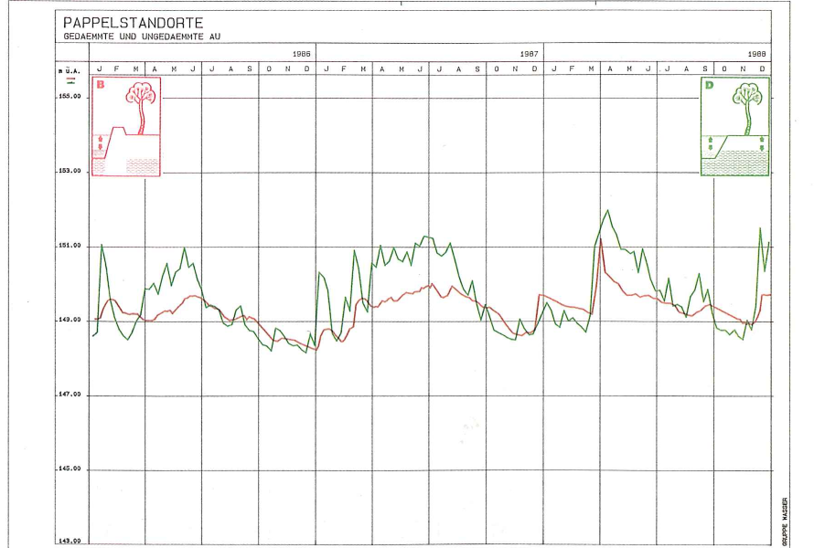

# Dritte Ergänzung unserer Einwendung – Dauerwirkung der Untergrundabdichtung auf Grundwasserdynamik und Baumbestand

 

Martin Schwenzer · Stephanie Sabatier 
Wöhrdstraße 41 · 93059 Regensburg

Stadt Regensburg 
Umweltamt – Planfeststellungsbehörde 
z. Hd. Frau Barbara Wittmann 
Bruderwöhrdstraße 15 b 
93055 Regensburg

**15. Oktober 2026**

---

## Dritte Ergänzung unserer Einwendung im wasserrechtlichen Planfeststellungsverfahren gem. § 68 Abs. 1 i. V. m. § 67 Abs. 2 WHG – Hochwasserschutz an der Donau im Bereich „Unterer Wöhrd“, Stadt Regensburg – Abschnitt H

**(AZ.: 31.1.2. Pl-HWS-H/Unterer Wöhrd)**

**Bezug:** Unsere fristgerechte Einwendung vom 14.01.2026 (insbesondere Abschnitte 4.4, 4.5 und 4.10); Erörterungstermin vom 22.07.2026; Ergänzung vom 02.08.2026 (übermittelt am 06.08.2026); zweite Ergänzung vom 14.10.2026 (gemeinsam mit Florian Gebauer, gleichzeitig übermittelt)

---

 

Sehr geehrte Frau Wittmann,
sehr geehrte Damen und Herren,

wir ergänzen unsere Einwendung um einen Gesichtspunkt, für den uns erst jetzt ein fachlicher Beleg vorliegt: die **dauerhafte Wirkung der Untergrundabdichtung auf die Grundwasserdynamik und damit auf den Baumbestand** innerhalb der Schutzlinie und in deren Umfeld. Die Planunterlagen stufen diese Wirkung als unerheblich ein. Eine vergleichende Untersuchung der Stadt Wien an Auwaldstandorten, denen ein Hochwasserschutzdamm zum Zeitpunkt der Untersuchung seit rund hundert Jahren Überflutung und Grundwasserspitzen nahm, kommt zum gegenteiligen Ergebnis (**Anlage 1**).

Der Gegenstand betrifft die Schutzgüter nach § 2 Abs. 1 Nr. 2, 3 und 5 UVPG (Pflanzen, Boden, Wasser und ihre Wechselwirkungen) und ist damit nach der Bekanntmachung vom 17.10.2025 nicht vom Einwendungsausschluss erfasst. Er vertieft unsere fristgerechte Einwendung (Abschnitt 4.5: dauerhafte Veränderung des hydrogeologischen Systems durch die Untergrundabdichtung) und die im Erörterungstermin vorgetragene Anregung, das Grundwassermodell um Niedrigwasser-Szenarien zu ergänzen und die Folgen dauerhaft veränderter Grundwasserstände auch für die Vegetation zu bewerten. Unabhängig davon hat die Planfeststellungsbehörde den Sachverhalt von Amts wegen zu ermitteln (Art. 24 Abs. 1 und 2 BayVwVfG), die Ergebnisse eigener Ermittlungen in die zusammenfassende Darstellung einzubeziehen (§ 24 Abs. 1 Satz 3 UVPG), Nachbesserungen des UVP-Berichts zu verlangen, soweit er den gegenwärtigen Wissensstand nicht berücksichtigt (§ 16 Abs. 5 Satz 1, Abs. 7 Satz 2 UVPG), und auf hinreichend aktueller Grundlage zu entscheiden (§ 25 Abs. 3 UVPG).

---

## 1. Wie die Planunterlagen die Dauerwirkung bewerten

**a) Das Grundwassermodell bewertet die Dauerwirkung allein am Mittelwasser.** Die Untergrundabdichtung wird „bis zum Grundwasserstauer in Tiefen bis zu 20 m unter Gelände“ geführt (Anlage A, S. 21). Das Fachgutachten zum Grundwassermodell (Anlage F 3.2, Teil 3) legt seiner Bewertung vier Rechenläufe zugrunde, „Mittel- und Hochwasser, jeweils Bezugs und Planungszustand“ (ebd., S. 40); betrachtet wurde „instationär das für den Hochwasserschutz maßgebende Hochwasserereignis (HQB (HQ100)) …, stationär dagegen mittlere Verhältnisse, die hinsichtlich der dauerhaften Auswirkungen der geplanten Maßnahme maßgebend sind“ (ebd., S. 29). Das Ergebnis lautet: „Die dauerhaften Änderungen der Grundwasserverhältnisse durch die geplante Untergrundabdichtung sind unerheblich (Änderung der Grundwasserstände im einstelligen Zentimeterbereich, bei einer natürlichen Schwankungsbreite im Meterbereich)“ (ebd., S. 43; ebenso Anlage A, S. 75). Zugleich hält das Gutachten fest: „Durch die Behinderung des Grundwasseraustausches mit der Donau durch die Untergrundabdichtung reduziert sich der Grundwasserumsatz im quartären Grundwasserleiter des Unteren Wöhrds … Besonders ausgeprägt ist dies im westlichen Bereich der Insel und an einspringenden Ecken der Untergrundabdichtung (nordöstliches Ende der Untergrundabdichtung, Bereich „Obstwiesen“). In diesen Bereichen findet bei länger gleichbleibendem Donauwasserstand … nur noch ein kleiner Grundwasserumsatz statt“ (ebd., S. 40). Dass keine „dauerhafte Stagnation“ vorliege, begründet das Gutachten mit den schwankenden Wasserständen der Donau: Auch im Planungsfall folge der Grundwasserstand der Hochwasserwelle, „es stellt sich nur eine Dämpfung in der Amplitude ein“ (ebd., S. 41, mit Abbildung 13 für die Obstwiese Wöhrdstraße 41; dazu Abschnitt 3 b). Der Restspalt unter der Dichtwand, der im Hochwasserfall angesetzt wird, bleibt bei mittleren Verhältnissen unberücksichtigt, weil er „die Sperrwirkung der Untergrundabdichtung … verkleinert“ (ebd., S. 32, 34).

**b) Die Umweltverträglichkeitsstudie erklärt die Dämpfung für unschädlich.** Für den Baumbestand innerhalb der Untergrundabdichtung führt die Umweltverträglichkeitsstudie (Anlage D 1.0, nachfolgend „UVS“) aus, es komme „letztendlich nur zu einer Dämpfung des maximalen GW-Anstiegs über einen Zeitraum von 14–16 Tagen“; statt eines Anstiegs bis oder über Gelände würden die maximalen Grundwasserstände „kurzzeitig auf ein Niveau von ca. −0,5 bis −2,8 m unter Gelände abgesenkt. Das Absenkungsniveau bleibt dabei immer deutlich über dem Mittelwasserspiegel, sodass keine relevanten Verschlechterungen für Baumbestände innerhalb der Untergrundabdichtung zu erwarten sind. Der Baumbestand auf der Insel ist an viel stärkere Grundwasserspiegelschwankungen bzw. Überflutungen gewöhnt. Zudem besteht bei künftig trockeneren Bodenverhältnissen die Möglichkeit, nachteilige Wirkungen durch Bewässerungsmaßnahmen zu vermeiden. Nasseren, stagnierenden Verhältnissen könnte bei Bedarf durch eine Anpassung der Vegetationsstruktur begegnet werden“ (UVS, S. 132; ebenso S. 209). Unter den Überwachungsmaßnahmen empfiehlt die UVS, „die Entwicklung von Gehölzbeständen innerhalb der Untergrundabdichtung und außerhalb der Untergrundabdichtung im Bereich Wald am Jakobigelände PA 2 und Obstgarten Wöhrdstr. 41, PA 1 zu beobachten. Sollten sich Auffälligkeiten an diesen Gehölzen zeigen, wie z. B. zunehmende Krankheiten oder gar Absterben, dann könnten bei Bedarf Anpassungen vorgenommen [werden], wie z. B. das Pflanzen von Arten, die mit den Veränderungen des Bodenwasserhaushalts besser zurechtkommen“ (UVS, S. 233; ebenso S. 251; dazu bereits unsere Einwendung, Abschnitt 4.10).

**c) Befund.** Die Planunterlagen beschreiben die Wirkung zutreffend: Ausfall der Überflutung, Kappung der Grundwasserspitzen, verringerter Grundwasserumsatz, veränderter Bodenwasserhaushalt. Sie bewerten sie aber am Mittelwert und stützen die Unerheblichkeit auf zwei Annahmen, die fachlich nicht belegt werden. Die erste, das Absenkungsniveau bleibe „deutlich über dem Mittelwasserspiegel“, trifft auch auf die gedämmte Au bei Wien zu, in der eine Schwankungsbreite von über zwei Metern erhalten blieb und der Standort sich gleichwohl veränderte (Abschnitt 2). Die zweite, der Bestand sei „an viel stärkere Grundwasserspiegelschwankungen bzw. Überflutungen gewöhnt“, spricht nicht für, sondern gegen die Unerheblichkeit: Ein an diese Dynamik angepasster Bestand reagiert auf ihren Wegfall. Dass die UVS selbst Bewässerung, einen Artenwechsel und die Beobachtung auf „Absterben“ in Aussicht stellt, zeigt, dass sie die Veränderung des Standorts erwartet. An anderer Stelle erkennt sie den Mechanismus ausdrücklich an: Die Auwaldstreifen im Stadtbereich bewertet sie unter anderem wegen „fehlender Dynamik (Hochwasserschutz)“ nur als mäßig (UVS, S. 55).

---

## 2. Die Untersuchung der Stadt Wien: Gedämmte Au – Geflutete Au

**a) Gegenstand und Methode.** Die Stadt Wien (Magistratsabteilung 49, Forstamt) hat von 1987 bis 1990 untersuchen lassen, wie sich die Abdämmung von Auwaldstandorten durch den Hochwasserschutzdamm auswirkt (Studie vom Dezember 1990, Nachdruck 2016 als Heft 41 der Wissenschaftlichen Reihe des Nationalparks Donau-Auen; Auszug als Anlage 1, Seitenangaben nach der gedruckten Zählung). Verglichen wurden je ein Standort der Silberweide und der Weißpappel in der Unteren Lobau, die seit Errichtung des Hubertusdamms Ende des 19. Jahrhunderts vom Strom getrennt ist, mit je einem gleichartigen Standort in der weiterhin überfluteten Mannswörther Au am gegenüberliegenden Ufer (vier Vergleichsstandorte; S. 19, 30). Beteiligt waren die Institute für Forstökologie und für forstliche Ertragslehre der Universität für Bodenkultur Wien sowie ein hydrologisches Ingenieurbüro (Impressum; S. 19, 21). Ausgewertet wurden gemessene und für den Langzeitvergleich 1956–1988 berechnete Grundwasserganglinien (S. 22), Bohrprofile, Profilgruben mit Wurzelzählung, Bodenwasserspannung, Boden- und Streuanalysen sowie Bestandesaufnahmen an über 2.000 Probestämmen mit Zuwachsmessungen an ausgewählten Bäumen (S. 21 ff., 30 ff., 44, 48).

**b) Befunde.** Die Abdämmung hat die Grundwasserdynamik in der Lobau gedämpft, nicht beseitigt: Die Extremwerte der Grundwasseramplitude 1956–1988 betragen gedämmt 2,1 m (Weide) und 2,6 m (Pappel), geflutet 5,3 m und 5,8 m (Tabelle 7, S. 24). Der Pappelstandort der gedämmten Au hat an 23 Tagen im Jahr Grundwasser in der durchwurzelbaren Deckschicht, der geflutete an 300 Tagen (Tabelle 8, S. 24). Die Studie beschreibt den Mechanismus (S. 23): Durch die Abdämmung „entfallen die Überschwemmungen“, die Grundwasserschwankungen werden „sowohl in der Höhe als auch zeitlich gedämpft“, die periodische Durchlüftung des Bodens durch das schwankende Grundwasser („Lungeneffekt“) fällt aus. „Dadurch ergeben sich sowohl für die feuchten Weidenstandorte als auch für die trockeneren Pappelstandorte eindeutige, einschränkende Wachstumsbedingungen in den gedämmten Auwaldökosystemen.“ Für den trockeneren Pappelstandort, der dem Unteren Wöhrd am nächsten kommt, stellt die Studie „durch den seltenen Grundwasseranschluß eine starke Abhängigkeit vom Niederschlag“ fest; bei fehlendem Niederschlag könne „durch den fehlenden Grundwasserkontakt Trockenstreß für die Vegetation entstehen“ (S. 39); der negative Einfluss sei dort „durch den häufigen Wassermangel, der vom meist fehlenden Anschluß des Grundwassers an die Deckschichte hergeleitet werden kann, gegeben“ (S. 47). Die Feinwurzeln konzentrieren sich in den obersten 20 cm, was die Autoren als Ausdruck der „starken Abhängigkeit dieses Auwaldbestandes von den Niederschlägen während der Vegetationszeit“ werten (S. 33 f.). Das Höhenwachstum ist verzögert, bei der Silberweide um bis zu zehn Jahre, bei der Weißpappel in der Jugend (S. 44–46). Die Kohlenstoff- und Stickstoffvorräte des Bodens liegen in der gefluteten Au bei 165 bis 177 % der gedämmten (Tabellen 16 und 17, S. 41), auch wenn die Autoren wegen der hohen Gesamtvorräte der jungen Flusssedimente „in absehbarer Zeit“ keine Mangelerscheinungen erwarten (S. 43). Ihr Fazit: Die Unterschiede „können zum Großteil auf die fehlenden Überflutungen und die eingeengte Schwankungsbreite des Grundwassers in der abgedämmten Unteren Lobau zurückgeführt werden“ (S. 43); für Erhalt und Wiederherstellung von Auwald seien „die dynamischen Wasserverhältnisse eine Grundvoraussetzung“ (S. 49).

<figure style="margin: 1em 0;">

<figcaption style="font-size: 10pt; margin-top: 4px;"><strong>Abbildung 1:</strong> Grundwasserganglinien 1986–1988 an den Pappelstandorten der gedämmten Au (rot, Untere Lobau) und der gefluteten Au (grün, Mannswörth): gedämpfte Hochstände bei ähnlichen Tiefständen. Aus Haubenberger und Weidinger 1990, Abbildung 20, S. 29 (© Stadt Wien, MA 49).</figcaption>
</figure>

**c) Übertragbarkeit.** Die Lobau ist ein geschlossener Auwald auf Feinsand über Kies, der Untere Wöhrd eine bebaute Insel mit Straßen-, Garten- und Uferbäumen; der Hubertusdamm ist ein Erddamm ohne Untergrundabdichtung, die hier geplante Dichtwand reicht bis zum Grundwasserstauer und wird durch eine Binnenentwässerung ergänzt. In der Lobau kam zur Dämpfung der Schwankungen ein Absinken des Grundwasserstands durch das Einpegeln der Altarme hinzu (S. 13, 23), am Weidenstandort außerdem ein stagnierender Rückstau bei Hochwasser (S. 24); beides entfällt hier. Die Vergleichsau ist forstlich intensiv bewirtschaftet, mit hohem Anteil an Kanadapappel (S. 16) und tonreicheren Böden (S. 35); die Autoren benennen diese Störgrößen selbst (S. 48). Wir übertragen deshalb weder die Befunde zur Vergleyung am dauernd nassen Weidenstandort noch die zur Verjüngung aus Samen, die für Garten- und Straßenbäume ohne Belang ist. Übertragbar sind drei Punkte. Erstens zeigt die Studie, dass nicht der mittlere Grundwasserstand, sondern die Schwankungsbreite und die Zahl der Tage mit Grundwasser im Wurzelraum über den Standort entscheiden; genau diese Größen weisen die Planunterlagen weder für den Bezugs- noch für den Planungszustand aus. Zweitens blieb in der gedämmten Au eine Schwankung von 2,1 bis 2,6 m erhalten, die Hochstände lagen also weiterhin deutlich über dem mittleren Grundwasserstand, und die Standortveränderung trat gleichwohl ein; das Argument der UVS, das Absenkungsniveau bleibe „deutlich über dem Mittelwasserspiegel“, trägt daher nicht. Drittens beschreibt die Studie für den trockeneren gedämmten Standort Niederschlagsabhängigkeit und Wassermangel (S. 39, 47); das ist die Lage, in der sich der Regensburger Baumbestand nach dem Baumzustandsbericht 2025 schon heute befindet (Abschnitt 3 b). Dass der Flurabstand bei Mittelwasser im Westen des Schutzbereichs und im Obstgarten „in der Regel mindestens 3 m“ beträgt (UVS, S. 132), ist für diese Frage ohne Bedeutung: Maßgeblich ist, wie oft und wie lange das Grundwasser bei Hochwasser den Wurzelraum erreicht, heute bis an oder über Gelände, künftig 0,5 bis 2,8 m darunter.

---

## 3. Was das für den Unteren Wöhrd bedeutet

**a) Innerhalb der Schutzlinie.** Für den gesamten Baumbestand innerhalb der Untergrundabdichtung entfallen mit dem Vorhaben die Überflutungen. Die Grundwasserspitzen werden beim Bemessungshochwasser auf 0,5 bis 2,8 m unter Gelände gekappt (UVS, S. 132); bei kleineren Hochwassern greift die Kappung, sobald das Grundwasser das Niveau der Binnenentwässerung erreicht (Anlage D 2.0, S. 82), wie weit, sagen die Planunterlagen nicht. Über die Lebensdauer des Bauwerks betrachtet ist das die Situation der gedämmten Au. Welche Bäume das betrifft, sagen die Planunterlagen ebenfalls nicht; das Baumkataster (Anlage D 7) erfasst nur den potenziellen Eingriffsbereich (Anlage D 7.0, S. 5). Eine Bewertung nach Beständen, Arten und Alter fehlt. Dieser Baumbestand prägt zugleich unser Wohnumfeld; auf seine kleinklimatische und gesundheitliche Funktion haben wir in der Ergänzung vom 02.08.2026 (Abschnitt 2) hingewiesen.

**b) Der Obstgarten Wöhrdstraße 41.** Die UVS zählt den Obstgarten zu den „wertgebenden grundwasserabhängigen Landökosystemen“, die außerhalb der Untergrundabdichtung verbleiben und „damit weiterhin direkt an die Hydrodynamik der Aue angebunden bzw. geringeren Veränderungen der Grundwasserverhältnisse ausgesetzt“ seien. Im selben Absatz räumt sie ein, dass bei länger gleichbleibendem Donauwasserstand „bereichsweise nur noch ein kleiner Grundwasserumsatz stattfindet (im Westen des Schutzbereichs, im Bereich Obstgarten Wöhrdstr. 41)“ (UVS, S. 132; ebenso Anlage D 2.0, S. 70, und Anlage F 3.2, Teil 3, S. 40). Abbildung 13 des Grundwassermodells zeigt für dieselbe Fläche beim Bemessungshochwasser einen um rund 0,9 bis 1,0 m niedrigeren Scheitel (Abbildung 2); für kleinere Hochwasser, bei denen die Binnenentwässerung läuft, und für Trockenjahre fehlt jede Angabe. Der Landschaftspflegerische Begleitplan (Anlage D 2.0, nachfolgend „LBP“) führt als Vorteil der Vorzugsvariante den „Erhalt/langfristige Sicherung der Streuobstwiese“ an (S. 57 f.; dazu unsere zweite Ergänzung, Abschnitt 2 c); eine Sicherung des Standorts setzt voraus, dass seine Wasserdynamik erhalten bleibt. Diese naturschutzfachliche Einstufung betrifft den Wasserhaushalt des Standorts; über die bauplanungsrechtliche Zuordnung des Gartens, die Gegenstand unserer zweiten Ergänzung ist, sagt sie nichts. Zugleich sieht der LBP auf dem Grundstück 18 Neupflanzungen auf der Streuobstwiese und 3 im Garten vor, zusammen 21 bei 23 Fällungen (Anlage D 2.5, Tabelle 5e). Diese Jungbäume sollen unter Standortbedingungen anwachsen, die das Vorhaben verschlechtert. Der Baumzustandsbericht 2025 des Umweltamts (Beschlussvorlage VO/26/23217/31 für den Ausschuss für Umweltfragen, Natur- und Klimaschutz vom 15.07.2026, S. 3 f.; Anlage 1 unserer Ergänzung vom 02.08.2026) hält fest, dass bei den städtischen Altbäumen „die Feinwurzeln durch die vergangenen Trockenjahre teilweise so stark geschädigt oder abgestorben“ sind, „dass dies durch einzelne niederschlagsreiche Jahre nicht mehr kompensiert werden kann“, dass „viele Neupflanzungen ohne zusätzliches Gießen absterben“ und dass ein Ersatzbaum „unter ungünstigen (oder ungünstig gewordenen) Standortbedingungen … in der Regel nicht das Grünvolumen eines gefällten Altbaums ersetzen“ kann. Der Baumbestand steht also schon heute unter Trockenstress; das Vorhaben dämpft die Hochstände, über die der Boden bislang periodisch durchfeuchtet wird, und beziffert diese Dämpfung nur für ein einziges Ereignis.

<figure style="margin: 1em 0;">

<figcaption style="font-size: 10pt; margin-top: 4px;"><strong>Abbildung 2:</strong> Berechnete Grundwasserganglinien für die Obstwiese Wöhrdstraße 41 beim Bemessungshochwasser, Bezugsfall (blau) und Planungsfall (orange). Aus Anlage F 3.2, Teil 3, Abbildung 13, S. 41.</figcaption>
</figure>

**c) Niedrigwasser und Klimawandel.** Nach der UVS ist „aufgrund der prognostizierten Häufigkeit von Extremwetterereignissen (Dürren mit Niedrigwasserständen, Starkregen mit Hochwasserereignissen) mit extremeren Zuständen des Grundwasserspiegels zu rechnen“ (UVS, S. 161). Ein Niedrigwasser-Lastfall wurde nicht gerechnet; der Restspalt unter der Dichtwand wurde bei mittleren Verhältnissen nicht angesetzt (Anlage F 3.2, Teil 3, S. 32, 34, 40). Gerade für Trockenjahre, in denen die Studie am gedämmten Standort Wassermangel erwartet, fehlt damit jede Aussage.

**d) „Bei Bedarf“ ist keine Maßnahme.** Der Erläuterungsbericht räumt ein, dass die Untergrundabdichtung „in hochwasserfreien Zeiten zu unerwünschten Effekten (z. B. dauerhafte Absenkungen oder Aufhöhungen des Grundwasserspiegels) führen“ kann, „die durch Abhilfemaßnahmen ausgeglichen werden müssten“ (Anlage A, S. 21). Bewässerung und Artenwechsel werden in der UVS als Möglichkeit genannt, nicht als Maßnahme festgesetzt. Der LBP sieht Bewässerung nur bauzeitlich für einzelne Gärten (S. 71; Maßnahme V 4.1, S. 97) und für die Anwuchszeit der Neupflanzungen vor (S. 105). Wer über die Lebensdauer des Bauwerks welche Bäume bewässert, wer die Kosten trägt und ab welchem Befund Ersatz geschuldet ist, bleibt offen. Für die Eigentümerinnen und Eigentümer der Gärten innerhalb der Schutzlinie und für uns als langjährige Bewohner und Nutzer des Obstgartens ist das eine dauerhafte Last, die das Vorhaben verursacht und die Planunterlagen nicht benennen.

---

## 4. Anträge

Ergänzend zu unserer Einwendung (Abschnitte 4.4, 4.5 und 4.10) und zu den im Erörterungstermin vorgetragenen Anliegen zum Grundwassermodell beantragen wir **zur Sachverhaltsaufklärung und Nachbesserung der Unterlagen** (Art. 24 Abs. 1 und 2 BayVwVfG; § 16 Abs. 5 Satz 1 und Abs. 7 Satz 2, § 24 Abs. 1 Satz 3 UVPG) die Nr. 1 und 2, **für den Fall der Planfeststellung als Schutzvorkehrungen und Überwachungsmaßnahmen** (Art. 74 Abs. 2 Satz 2 und Abs. 3 BayVwVfG; § 26 Abs. 1 Nr. 1 und 2, § 28 Abs. 2 UVPG) die Nr. 3 und 4 und **für die Abwägung** (Art. 74 Abs. 2 Satz 1 BayVwVfG; § 25 Abs. 2 UVPG; § 15 Abs. 1 BNatSchG) die Nr. 5:

1. **Ergänzung des Grundwassermodells (Anlage F 3.2, Teil 3).** Zu berechnen sind (a) ein stationärer Niedrigwasser-Lastfall (NQ und MNQ, Niedrigwasserabfluss und mittlerer Niedrigwasserabfluss) im Bezugs- und im Planungszustand, mit und ohne Restspalt unter der Dichtwand, um die Bandbreite der Dauerwirkung auszuweisen; (b) aus den instationären Ganglinien an den Messstellen und Beobachtungspunkten der dortigen Anlagen 3.5.1 bis 3.5.15 sowie für die Obstwiese Wöhrdstraße 41 (Abbildung 13) die Zahl der Tage je Ereignis, an denen der Grundwasserstand im Bezugs- und im Planungszustand den Wurzelraum erreicht, bei Flurabständen unter 2 m (Wurzelraum der Obst- und Laubbäume einschließlich kapillarem Aufstieg) und unter 3 m (der in der UVS, S. 132, genannte Flurabstand bei Mittelwasser), für das Bemessungsereignis und für ein häufigeres Hochwasser, bei dem die Binnenentwässerung bereits betrieben wird, etwa das zur Validierung des Modells herangezogene Hochwasser vom Januar 2011 (ca. HQ10); (c) die Karte der Flurabstandsbereiche beim maximalen Grundwasserstand (dortige Anlage 3.6) auch für den Bezugszustand.
2. **Fachliche Bewertung der Dauerwirkung für das Schutzgut Pflanzen.** UVS und LBP sind um eine Bewertung der dauerhaften Wirkungen von Untergrundabdichtung und Binnenentwässerung (Ausfall der Überflutung, Dämpfung der Grundwasserspitzen, verringerter Grundwasserumsatz) auf die Gehölzbestände innerhalb der Schutzlinie und auf den Obstgarten Wöhrdstraße 41 zu ergänzen, unter Auseinandersetzung mit der Untersuchung der Stadt Wien (Anlage 1) und unter Benennung der betroffenen Bäume: nach Beständen (Lage, Fläche, Hauptbaumarten, Altersklasse) für den gesamten Schutzbereich; einzelbaumgenau für die von der UVS selbst zur Beobachtung vorgesehenen Flächen (Wald am Jakobigelände, Obstgarten Wöhrdstraße 41), für die Bereiche, in denen das Grundwassermodell den verringerten Grundwasserumsatz als „besonders ausgeprägt“ beschreibt (Anlage F 3.2, Teil 3, S. 40), und für die im Baumkataster (Anlage D 7.2) erfassten Bäume innerhalb der Schutzlinie mit einem Stammumfang über 100 cm. Die Beschreibung hat die langfristigen und ständigen Auswirkungen zu umfassen (§ 16 Abs. 1 Satz 1 Nr. 5 und Abs. 3 UVPG i. V. m. Anlage 4 Nr. 4 Buchst. a UVPG), für das Schutzgut Boden auch die Veränderung der organischen Substanz (Anlage 4 Nr. 4 Buchst. b UVPG), den gegenwärtigen Wissensstand zu berücksichtigen (§ 16 Abs. 5 Satz 1 UVPG) und die Lücke der bisherigen Methodik offenzulegen (Anlage 4 Nr. 11 UVPG). Die dauerhafte Veränderung des mit der belebten Bodenschicht in Verbindung stehenden Grundwasserspiegels ist als Eingriff nach § 14 Abs. 1 BNatSchG zu prüfen und, soweit erheblich, im LBP nach § 15 Abs. 1 und 2 BNatSchG zu behandeln (Vermeidung, Begründung der Unvermeidbarkeit, Ausgleich oder Ersatz).
3. **Konkretisierung der Abhilfe.** Es ist festzulegen, für welche Bäume und Flächen die in der UVS genannten Bewässerungsmaßnahmen und Anpassungen der Vegetationsstruktur vorgesehen sind, über welchen Zeitraum, nach welchen Auslösekriterien und auf wessen Kosten; die Festlegung ist als Maßnahme in den LBP aufzunehmen (§ 16 Abs. 1 Satz 1 Nr. 4 UVPG) und dem Vorhabensträger als Schutzvorkehrung aufzuerlegen (Art. 74 Abs. 2 Satz 2 BayVwVfG), ergänzend zu Antrag 2 unserer Ergänzung vom 02.08.2026 (Entwicklungspflege der Neupflanzungen).
4. **Überwachung und Beweissicherung als Anordnung, nicht als Empfehlung.** Die in der UVS empfohlene Beobachtung der Gehölzbestände innerhalb der Untergrundabdichtung, im Wald am Jakobigelände und im Obstgarten Wöhrdstraße 41 (UVS, S. 233, 251) ist als Überwachungsmaßnahme nach § 28 Abs. 2 UVPG anzuordnen, dem Vorhabensträger aufzugeben (§ 28 Abs. 2 Satz 2 UVPG) und im Planfeststellungsbeschluss zu beschreiben (§ 26 Abs. 1 Nr. 2 UVPG): mit Messstellen für Grundwasserstand und Bodenwasserspannung im Wurzelraum, einer Beweissicherung des Baumbestands vor Baubeginn (Vitalität, Stammumfang, Kronenzustand sowie Bodenprofile mit Aufnahme der Durchwurzelungstiefe an Referenzstandorten innerhalb und außerhalb der Schutzlinie) als Schutzvorkehrung nach Art. 74 Abs. 2 Satz 2 BayVwVfG, Wiederholungsaufnahmen in festen Abständen über die Betriebszeit, Auslösekriterien (etwa Vitalitätsstufe, Zuwachsrückgang, Absterben) und jährlicher Berichtspflicht gegenüber der Planfeststellungsbehörde (§ 17 Abs. 7 BNatSchG). Die im Erläuterungsbericht vorgesehene Fortführung der Grundwasseraufzeichnungen „mindestens 5 Jahre nach Abschluss der Maßnahmen“ (Anlage A, S. 75) ist entsprechend zu verlängern und um die Gehölzbeobachtung zu ergänzen. Soweit Ausmaß und zeitlicher Verlauf der Wirkung auch nach den Ergänzungen nach Nr. 1 und 2 nicht abschließend beurteilt werden können, ist die Entscheidung über weitere Schutzvorkehrungen, Gegenmaßnahmen und Ersatz zu Lasten des Vorhabensträgers nach Art. 74 Abs. 3 BayVwVfG vorzubehalten und an diese Auslösekriterien zu knüpfen. Die Berichte sind den Eigentümerinnen und Eigentümern sowie den Bewohnerinnen und Bewohnern der betroffenen Grundstücke zugänglich zu machen.
5. **Einstellung in die Abwägung.** Der dauerhafte Verlust der Grundwasserdynamik für den Baumbestand ist als Nachteil des Vorhabens in die Abwägung und in den Vergleich der Varianten einzustellen (Art. 74 Abs. 2 Satz 1 BayVwVfG; § 25 Abs. 2 UVPG). Nach § 15 Abs. 1 Satz 2 BNatSchG ist zu prüfen, ob der Schutzzweck am gleichen Ort mit geringerer Beeinträchtigung erreichbar ist; das gilt insbesondere für das in unserer Einwendung (Abschnitt 4.4) und in der zweiten Ergänzung beantragte frühere Ende der Untergrundabdichtung auf Wöhrdstraße 41, das das Schutzziel unberührt lässt.

---

## 5. Verfahrensbitten

1. Wir bitten um **Eingangsbestätigung** für diese Ergänzung.
2. Wir bitten, diese Ergänzung in die zusammenfassende Darstellung nach § 24 UVPG und in die Abwägung einzubeziehen beziehungsweise die Darstellung entsprechend zu ergänzen. Werden das Grundwassermodell oder die UVS nach Abschnitt 4 Nr. 1 und 2 ergänzt, bitten wir um erneute Beteiligung nach § 22 Abs. 1 UVPG, mindestens um Zugänglichmachung nach § 19 Abs. 3 UVPG und um Gelegenheit zur Stellungnahme vor der Entscheidung.
3. Wir bitten um Zustellung des Planfeststellungsbeschlusses nach Art. 74 Abs. 4 Satz 1 BayVwVfG. Sollte die Zustellung nach Art. 74 Abs. 5 BayVwVfG durch öffentliche Bekanntmachung ersetzt werden, bitten wir um Mitteilung des Tages der Bekanntmachung und um Übersendung des Beschlusses (Art. 74 Abs. 5 Satz 4 BayVwVfG).
4. Wir bitten, uns wie bereits erbeten über den weiteren Verfahrensgang individuell zu informieren.

Mit freundlichen Grüßen

  

Martin Schwenzer &nbsp;&nbsp;&nbsp;&nbsp;&nbsp;&nbsp; Stephanie Sabatier

Wöhrdstraße 41, 93059 Regensburg

## Anlagen

1. Haubenberger, G. und Weidinger, H.: Gedämmte Au – Geflutete Au. Vergleichende Grundlagenforschung zur forstökologischen Beurteilung abgedämmter und gefluteter Auwaldstandorte östlich von Wien. Studie der Stadt Wien, Magistratsabteilung 49 (Hrsg.), Dezember 1990; Nachdruck: Wissenschaftliche Reihe Nationalpark Donau-Auen, Heft 41/2016 (© Stadt Wien, MA 49). Auszug: Umschlag, Titelblätter, Impressum 1990, Inhalt, S. 3, 5, 13, 15, 16, 19, 22–24, 29–34, 39, 41, 43–49, 51 sowie Rückseite des Nachdrucks mit Nutzungsbedingungen (32 Seiten). Die vollständige Studie (57 Seiten des Nachdrucks) stellen wir auf Wunsch zur Verfügung; sie ist unter www.donauauen.at (Wissenschaftliche Reihe, Heft 41) abrufbar.

Abbildungen im Text: 1 Grundwasserganglinien der Pappelstandorte 1986–1988 (Haubenberger und Weidinger 1990, Abbildung 20, S. 29); 2 Berechnete Grundwasserganglinien Obstwiese beim Bemessungshochwasser (Anlage F 3.2, Teil 3, Abbildung 13, S. 41).
