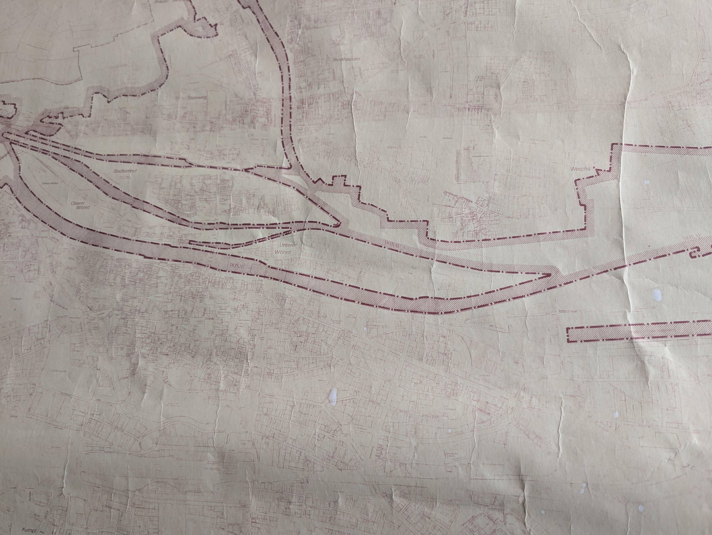

Anlage 2 zur Zweiten Ergänzung der Einwendungen Schwenzer · Sabatier · Gebauer (Wöhrdstraße 41) vom 14.10.2026 – AZ.: 31.1.2. Pl-HWS-H/Unterer Wöhrd

## Karte zum Geltungsbereich der Baumschutzverordnung der Stadt Regensburg von 1993

Foto der beim Umweltamt der Stadt Regensburg vorliegenden Karte, aufgenommen von Nils Deichner (Wöhrdstraße 1, 93059 Regensburg) bei seiner Einsichtnahme am 26.08.2026. Die Karte legte nach der Stellungnahme des Umweltamts vom 11.09.2026 (Anlage 1) den räumlichen Geltungsbereich der Baumschutzverordnung in der bis 2023 geltenden Fassung fest.

<figure style="margin: 1em 0;">

<figcaption style="font-size: 10pt; margin-top: 4px;">Übersicht mit Stadtamhof, Oberem und Unterem Wöhrd, Altstadt und Weichs. Der Ausschnitt Unterer Wöhrd ist als Abbildung 2 im Schreiben wiedergegeben.</figcaption>
</figure>
